<div align="center">

# 📝 Correção de Provas

**App para o professor gerar provas embaralhadas por aluno e corrigi-las pela câmera do celular.**


</div>

## 👥 Equipe

| Nome completo | GitHub |
|---|---|
| Kelcia Antiuk | [@KelciaAntiuk](https://github.com/KelciaAntiuk) |
| Pedro Martins do Nascimento | [@Pedro-Martins-Nascimento](https://github.com/Pedro-Martins-Nascimento) |
| Karen Amancio | [@KarenAmancio](https://github.com/KarenAmancio) |
| Letícia Parpineli | [@leparpineli](https://github.com/leparpineli) |
| Eduardo | [@Eduardoszz](https://github.com/Eduardoszz) |

## 📑 Sumário

- [1. Visão Geral](#1-visão-geral)
  - [1.1 Entrega N3 (atual)](#11-entrega-n3-atual)
  - [1.2 Entrega N2](#12-entrega-n2)
  - [1.3 Entrega N1](#13-entrega-n1)
- [2. Requisitos](#2-requisitos)
  - [2.1 Funcionais (RF)](#21-funcionais-rf)
  - [2.2 Não Funcionais (RNF)](#22-não-funcionais-rnf)
- [3. Telas do Sistema](#3-telas-do-sistema)
- [4. Modelo de Dados](#4-modelo-de-dados)
- [5. Stack Tecnológica](#5-stack-tecnológica)
- [6. Estrutura de Pastas](#6-estrutura-de-pastas)
- [7. Como Executar o Projeto](#7-como-executar-o-projeto)
- [8. Backlog de Atividades](#8-backlog-de-atividades)
  - [8.1 N3](#81-n3)
  - [8.2 N2](#82-n2)
- [9. Como o grupo trabalha](#9-como-o-grupo-trabalha)
- [10. Documentação de apoio](#10-documentação-de-apoio)

---

## 1. Visão Geral

📌 **N1**

Aplicativo Flutter de uso exclusivo do professor para **gerar provas embaralhadas por aluno e corrigi-las pela câmera**, a partir de um QR code impresso em cada versão. Projeto acadêmico desenvolvido em grupo.

**Objetivo:** eliminar o trabalho manual de corrigir provas de múltipla escolha e, de quebra, dificultar a cola em sala.

O professor monta a prova a partir de um banco de questões, o app gera várias versões embaralhadas — cada uma com um QR code próprio ligado ao seu gabarito —, exporta tudo em PDF pronto para impressão e, depois da aplicação, corrige as folhas apontando a câmera do celular.

O aluno não usa o aplicativo: existe apenas como cadastro dentro de uma turma.

**[▶ Assistir à demonstração](https://youtu.be/ahXdrW6j_UQ)** (gravado na N1)

Legenda das tabelas de status: ✅ implementado · 🟡 parcial ou simulado · ⏳ previsto para as próximas entregas

### 1.1 Entrega N3 (atual)

📌 **N3**

Na N3 o app fecha o ciclo pedido pelo cliente: as alternativas marcadas passam a ser **lidas da foto do gabarito (OMR)**, o professor organiza o trabalho em **Disciplinas → Turmas → Alunos**, e cada versão da prova sai com um **caderno de questões e um gabarito separado, com o QR code só no gabarito**.

#### Escopo delimitado da N3

**Dentro da N3**

- Cadastro de professor com nome, e-mail e senha; recuperação de senha por e-mail.
- Organização em **Disciplinas → Turmas → Alunos**: alunos só existem dentro de uma turma e turmas só dentro de uma disciplina. Disciplinas e turmas aparecem como cartões quadrados, com um cartão "+" para criar.
- Banco de questões direto dentro de cada disciplina (as matérias da N2 deixaram de existir; questões antigas ficam no grupo "Sem disciplina" e podem ser movidas).
- Geração da prova com três opções independentes: **embaralhar alternativas**, **embaralhar questões** e **vincular a aluno**. Com o vínculo, cada versão já sai com um aluno diferente; um aluno não pode estar em duas versões e o app avisa quem ficou sem prova.
- Cada versão recebe uma letra (Prova A, B, C…). O PDF traz, para cada versão, o **caderno de questões** e, em página separada, o **gabarito da mesma letra**, com o QR code, os marcadores de canto e o aviso "marque a resposta com um X". O campo "Professor" usa o nome da conta, nunca o e-mail.
- Questões nunca são cortadas entre duas páginas do PDF.
- Exportação da prova em DOCX, para edição fora do app.
- Correção: validação de foco, luz e inclinação da foto; leitura do QR; **leitura das bolinhas (OMR)**; questões em branco, com marcação dupla ou rasura vão para a revisão do professor.
- Turma com abas **Alunos** e **Provas**: a correção de cada aluno, a nota de cada folha ou "Pendente" e, quando todas as folhas da prova foram corrigidas, a **planilha de notas da turma** (`.xlsx`).
- Estatística completa com acerto por disciplina, questões que mais derrubam a turma, **distribuição das alternativas marcadas por questão**, média por prova e ranking de alunos.
- Aviso global quando o aparelho fica sem conexão.

**Fora da N3**

- Leitura das páginas seguintes do gabarito quando a prova tem mais questões do que cabem em uma página: só a primeira página (a do QR) é fotografada, e as questões das outras páginas são marcadas pelo professor.
- Login com Google no APK distribuído: só funciona se a SHA-1 da chave que assinou o APK estiver cadastrada no Firebase (seção [7.3](#73-configurar-o-firebase)). Na apresentação, use e-mail e senha.
- Modo offline (o cliente já declarou que não haverá).

#### O que a N3 entrega de cada requisito

| Cód. | Onde está | Status na N3 |
|---|---|---|
| RF01 | Login / Criar conta / Esqueci minha senha | ✅ cadastro com nome, login com e-mail e senha ou Google, recuperação de senha por e-mail |
| RF02 | — | ✅ por construção: não existe fluxo de aluno no app |
| RF03 | Início › Disciplinas › Turmas | ✅ disciplinas com turmas dentro, salvas no Firestore |
| RF04 | Turma › Importar lista | 🟡 lê planilhas `.xlsx` (nome e matrícula); `.csv` ainda não |
| RF05 | Turma › aba Alunos | ✅ criar, editar e remover aluno |
| RF06 | Questões › disciplina | ✅ questões organizadas por disciplina |
| RF07 | Questões › formulário | ✅ enunciado, alternativas, gabarito e exclusão |
| RF08 | Provas › Nova prova | ✅ disciplina, turma e questões da disciplina; também cria questão sem sair da tela |
| RF09 | Provas › Nova prova › Opções | ✅ embaralhar alternativas, embaralhar questões e vincular a aluno |
| RF10 | Provas › Gerar versões | ✅ QR próprio por versão, impresso só no gabarito |
| RF11 | Provas › Gerar versões | ✅ um aluno por versão, sem repetir, com aviso de quem ficou sem prova |
| RF12 | Provas › Gerar versões | ✅ PDF com caderno e gabarito separados por versão; também DOCX |
| RF13 | Corrigir | ✅ câmera lendo o QR e localizando a versão |
| RF14 | Corrigir › versão | ✅ leitura das bolinhas pela foto; em branco, dupla ou rasura ficam "não identificadas" |
| RF15 | Corrigir › versão | ✅ o professor escolhe as não identificadas e pode corrigir qualquer leitura antes de confirmar |
| RF16 | Corrigir › versão | ✅ nota de 0 a 10 calculada ao confirmar e salva no Firestore |
| RF17 | Corrigir › Resultado / Turma › aba Alunos | ✅ por questão: alternativa marcada, gabarito e acerto |
| RF18 | Início › Estatística completa | ✅ inclui a distribuição das alternativas marcadas por questão |
| RF19 | Turma › aba Provas / Provas geradas | ✅ planilha `.xlsx` (matrícula, nome, nota e data) |
| RNF03 | Corrigir | ✅ foco, luz, inclinação e marcadores verificados antes de corrigir |
| RNF04 | PDF | ✅ nenhuma questão é cortada entre páginas |
| RNF07 | Firestore | ✅ regras em `firestore.rules`: cada professor só lê e grava em `professores/{uid}` |

#### Roteiro da apresentação

A demonstração segue a ordem definida pela professora. A tabela liga cada passo à funcionalidade avaliada (com a pontuação do formulário) e ao caminho no app.

| Passo | Funcionalidade (pontos) | Como fazer no app |
|---|---|---|
| 1. Criar conta de professor | 1. Criar conta (0,5) | Login › **Criar conta**: nome, e-mail e senha |
| 2. Fazer login com a conta criada | 2. Login (0,5) | Login › e-mail e senha › **Entrar** |
| 3. Criar turma/disciplina | 3. Criar turma/disciplina (0,75) | Início › cartão **"+"** cria a disciplina › **Nova turma** › dentro da turma, adicionar alunos |
| 4. Cadastrar uma questão na hora | 4. Banco de questões (1,0) | Questões › disciplina › **Nova questão** (a conta já tem outras questões cadastradas) |
| 5. Gerar prova com embaralhamento | 5. Gerar prova (1,25) | Provas › **Nova prova**: disciplina, turma, questões; marcar **Embaralhar questões** e **Embaralhar alternativas**; quantidade de versões › Gerar |
| 6. Abrir a prova e editar | 6. Verificar e editar (0,75) | Provas geradas › abrir a prova › editar (nome, questões, opções ou aluno vinculado) |
| 7. Exportar o PDF | 7. PDF + gabarito com QR (2,0) | Gerar versões › **Exportar PDF**: "PROVA A" (questões) e, em página separada, "GABARITO DA PROVA A" com o QR |
| 8 e 9. Corrigir a prova impressa pelo QR | 8. Correção pelo QR (2,5) | Corrigir › apontar para o gabarito › **Capturar** › conferir as alternativas lidas › **Confirmar correção** › nota na tela |
| 10. Mostrar que a nota foi salva | 8. (continuação) | Corrigir › **Corrigidas**, ou Turma › aba Alunos (selo da nota) |
| 11. Status da prova após as correções | 9. Status / relatório (0,75) | Turma › aba **Provas**: nota de cada folha e, com todas corrigidas, **Baixar planilha de notas**; Início › Estatística completa |

#### Preparação para o dia da apresentação

- **Conta de demonstração** com disciplina, turma, alunos e algumas questões já cadastradas.
- **Prova criada antes do dia**, impressa com 1 caderno de questões e 2 gabaritos.
  - A prova precisa ser gerada **com a versão atual do app**: em provas geradas antes da correção do QR, a Prova A de todas as provas tinha o mesmo QR, e a correção podia achar a prova errada.
  - Cada gabarito tem o QR da sua versão, e o app não deixa corrigir a mesma versão duas vezes ("já foi corrigida"). Por isso a prova da demonstração é gerada com **2 versões sem embaralhar**: o caderno é igual nas duas, e imprimem-se o caderno da Prova A e os gabaritos da Prova A e da Prova B.
  - Vincular um aluno a cada versão faz a nota aparecer com o nome do aluno.
- **Gabaritos marcados com X, de caneta preta ou azul**, uma alternativa por questão. Deixar uma questão com duas marcações mostra a revisão do professor.
- **Ensaio no celular da apresentação**: instalar o APK, corrigir uma folha de teste com boa luz e conferir a nota em Corrigidas.

#### Entregáveis da N3

| Entregável | Como gerar |
|---|---|
| Código-fonte compactado, sem a pasta `build` | `git archive --format=zip -o correcao-de-provas-n3.zip HEAD` (leva só os arquivos versionados: sem `build/`, `.dart_tool/` e sem os arquivos do Firebase) |
| README atualizado | este arquivo |
| APK funcional | seção [7.5 Gerar o APK](#75-gerar-o-apk) |
| Formulários de avaliação dos outros grupos | preenchidos durante as apresentações e enviados a cada grupo avaliado |

### 1.2 Entrega N2

📌 **N2**

Integração com banco de dados real: os dados mock da N1 foram substituídos por **Firebase Authentication** e **Cloud Firestore**, separados por professor. Turmas, alunos, matérias, questões, provas e correções continuam salvos depois que o app é fechado.

#### Escopo delimitado da N2

**Dentro da N2**

- Login com e-mail e senha ou com conta Google (Firebase Authentication).
- Dados salvos no Cloud Firestore, em `professores/{uid}/...`: cada professor só enxerga os próprios dados.
- Fluxo completo de montagem da prova: turmas → alunos → banco de questões → criar prova → gerar versões → exportar PDF.
- Correção: leitura do QR pela câmera, revisão das alternativas pelo professor, nota calculada e salva.
- Resultado por aluno, estatística da turma, boletim em PDF e relatório de notas em Excel.
- Layout responsivo: navegação inferior no celular e menu lateral em telas largas.

**Fora da N2**

- Reconhecimento real das marcações da folha (OMR). Hoje as alternativas aparecem **pré-preenchidas por sorteio** e o professor confere cada uma antes de confirmar (veja RF14).
- Recuperação de senha: o botão "Esqueci minha senha" avisa que ainda não está disponível.
- Modo offline (o cliente já declarou que não haverá).

#### O que a N2 entrega de cada requisito

| Cód. | Onde está | Status na N2 |
|---|---|---|
| RF01 | Login | ✅ e-mail e senha ou conta Google, pelo Firebase Authentication |
| RF02 | — | ✅ por construção: não existe fluxo de aluno no app |
| RF03 | Turmas | ✅ salvas no Firestore |
| RF04 | Turmas › Importar lista | 🟡 lê planilhas `.xlsx` (nome e matrícula); arquivos `.csv` ainda não são lidos |
| RF05 | Turmas › detalhe da turma | ✅ criar, editar e remover aluno |
| RF06 | Questões | ✅ matérias com criação e exclusão (a exclusão leva junto as questões da matéria) |
| RF07 | Questões › formulário | ✅ enunciado, alternativas, gabarito e exclusão |
| RF08 | Provas › Nova prova | ✅ também permite criar matéria e turma sem sair da tela |
| RF09 | Provas › Nova prova | ✅ mesma prova embaralhada ou conjuntos diferentes |
| RF10 | Provas › Gerar versões | ✅ QR próprio por versão, impresso no PDF |
| RF11 | Provas › Gerar versões | ✅ vínculo opcional com aluno da turma |
| RF12 | Provas › Gerar versões / Editor de layout | ✅ PDF gerado e enviado para impressão/compartilhamento |
| RF13 | Corrigir | ✅ câmera real lendo o QR da folha e localizando a versão |
| RF14 | Corrigir › versão | 🟡 **simulado**: as alternativas aparecem sorteadas, algumas como "não identificada"; a imagem da folha ainda não é processada |
| RF15 | Corrigir › versão | ✅ o professor confere e corrige cada alternativa antes de confirmar |
| RF16 | Corrigir › versão | ✅ nota de 0 a 10 calculada ao confirmar e salva no Firestore |
| RF17 | Corrigir › Resultado | ✅ por questão: alternativa marcada, gabarito e acerto |
| RF18 | Início › Estatística completa | ✅ acerto por matéria, questões com mais erros, média por prova e ranking de alunos |
| RF19 | Provas geradas | ✅ exporta as notas da prova em `.xlsx` (matrícula, nome, nota e data; formato em [docs/formato-relatorio-notas.md](docs/formato-relatorio-notas.md)) |
| RNF07 | Firestore | ✅ regras em `firestore.rules`: cada professor só lê e grava em `professores/{uid}` |

### 1.3 Entrega N1

📌 **N1**

Telas principais navegáveis, construídas em Flutter/Dart e populadas com **dados fictícios (mock)**, sem banco de dados.

#### Escopo delimitado da N1

**Dentro da N1**

- Telas principais construídas em Flutter/Dart e navegáveis por botão.
- Dados **mock**, mantidos em memória durante a execução.
- Fluxo completo de montagem da prova: turmas → alunos → banco de questões → criar prova → gerar versões → exportar PDF.
- Leitura de QR code pela câmera do dispositivo na tela de Correção.
- Layout responsivo: navegação inferior no celular e menu lateral em telas largas.

**Fora da N1**

- Banco de dados e persistência entre execuções — os dados somem ao fechar o app.
- Autenticação real: a tela de Login valida os campos, mas não verifica credenciais.
- Reconhecimento das marcações da folha (OMR) e cálculo de nota a partir da imagem.
- Tela de resultado por aluno e exportação de relatório em Excel.
- Modo offline (o cliente já declarou que não haverá).

#### O que a N1 entregou de cada requisito

| Cód. | Onde está | Status na N1 |
|---|---|---|
| RF01 | Login | 🟡 formulário com validação de e-mail e senha; não há verificação de credenciais |
| RF02 | — | ✅ por construção: não existe fluxo de aluno no app |
| RF03 | Turmas | ✅ |
| RF04 | Turmas › Importar lista | ✅ leitura real de arquivo `.xlsx` escolhido pelo usuário |
| RF05 | Turmas › detalhe da turma | ✅ criar, editar e remover aluno |
| RF06 | Questões | ✅ matérias com criação e exclusão |
| RF07 | Questões › formulário | ✅ enunciado, alternativas, gabarito e exclusão |
| RF08 | Provas › Nova prova | ✅ |
| RF09 | Provas › Nova prova | ✅ mesma prova embaralhada ou conjuntos diferentes |
| RF10 | Provas › Gerar versões | ✅ QR próprio por versão, impresso no PDF |
| RF11 | Provas › Gerar versões | ✅ vínculo opcional com aluno da turma |
| RF12 | Provas › Gerar versões / Editor de layout | ✅ PDF gerado e enviado para impressão/compartilhamento |
| RF13 | Corrigir | ✅ câmera real lendo o QR da folha |
| RF14 | Corrigir | 🟡 a folha é marcada como corrigida após a leitura do QR; a imagem ainda não é processada |
| RF15 | — | ⏳ |
| RF16 | Início | 🟡 média e contagem exibidas a partir de dados mock |
| RF17 | — | ⏳ |
| RF18 | Início | 🟡 erro por matéria da turma, com dados mock |
| RF19 | — | ⏳ |

---

## 2. Requisitos

📌 **N1**

### 2.1 Funcionais (RF)

| Código | Requisito |
|---|---|
| RF01 | O professor deve conseguir se autenticar |
| RF02 | Alunos não possuem acesso ao sistema |
| RF03 | Criar e listar turmas |
| RF04 | Importar lista de alunos via CSV/Excel |
| RF05 | Cadastrar, editar e remover aluno manualmente |
| RF06 | Organizar questões por matéria |
| RF07 | Criar, editar e excluir questões |
| RF08 | Criar prova selecionando matéria(s) e questões do banco |
| RF09 | Escolher o modo de geração da prova |
| RF10 | Gerar QR code único por versão |
| RF11 | Vincular opcionalmente uma versão a um aluno importado |
| RF12 | Exportar a prova em PDF pronta para impressão |
| RF13 | Ler o QR code para identificar a versão/gabarito |
| RF14 | Reconhecer automaticamente as alternativas marcadas na folha |
| RF15 | Permitir revisão/correção manual quando a leitura falhar |
| RF16 | Calcular a nota automaticamente |
| RF17 | Mostrar, por questão, qual alternativa cada aluno marcou |
| RF18 | Gerar estatística agregada da turma por questão |
| RF19 | Exportar relatório de notas em Excel |

### 2.2 Não Funcionais (RNF)

| Código | Requisito |
|---|---|
| RNF01 | Interface minimalista e com poucos toques |
| RNF02 | Leitura e cálculo praticamente instantâneos |
| RNF03 | Validar a qualidade da imagem antes de processar |
| RNF04 | Layout impresso consistente, sem cortar questão |
| RNF05 | Sem suporte a modo offline |
| RNF06 | Funcionar em dispositivos Android comuns |
| RNF07 | Dados vinculados somente ao professor autenticado |

---

## 3. Telas do Sistema

📌 **N1**, atualizado na N2 e na N3

> Os prints abaixo são da N2. Na N3 a aba Turmas virou **Disciplinas** (cartões de disciplina e, dentro, cartões de turma), o banco de questões fica dentro de cada disciplina e a turma tem as abas Alunos e Provas; a tabela [Todas as telas e rotas](#todas-as-telas-e-rotas) já está atualizada.

O app abre no **Login**. Depois de entrar, a navegação acontece por cinco abas (barra inferior no celular, menu lateral em telas largas). A aba **Corrigir** mostra um selo com a quantidade de versões geradas que ainda não foram corrigidas.

As telas abaixo seguem a ordem do fluxo do professor: entrar, cadastrar a turma, montar o banco de questões, gerar a prova e corrigir. Os prints foram tirados do app rodando com dados reais do Firestore, em uma conta de demonstração.

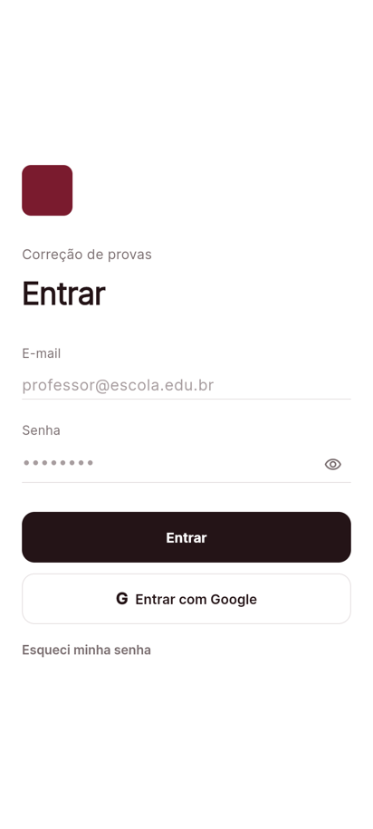
*Login: entrar com e-mail e senha ou com conta Google.*

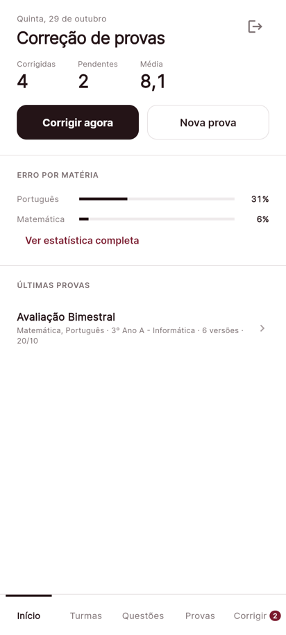
*Início: corrigidas, pendentes e média; atalhos "Corrigir agora" e "Nova prova"; últimas provas geradas.*

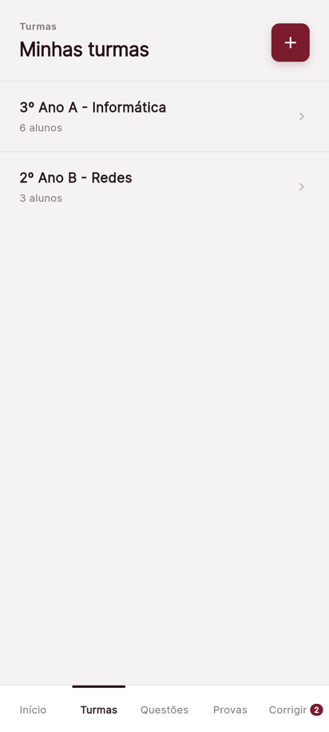
*Turmas: lista das turmas do professor, salvas no Firestore.*

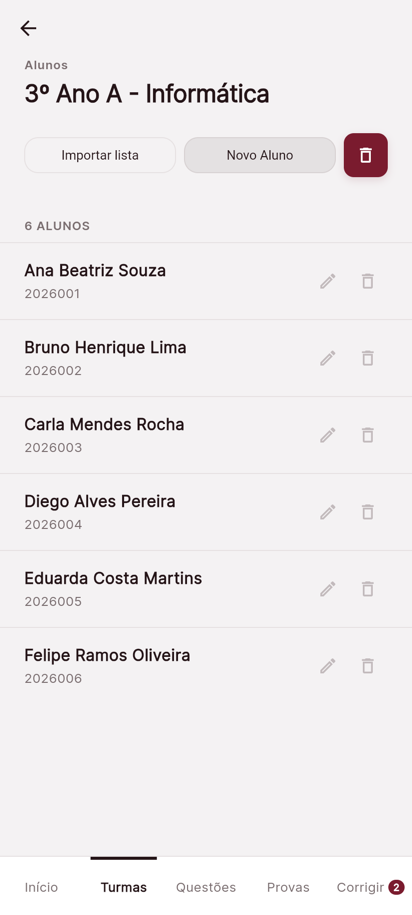
*Detalhe da turma: criar, editar e remover alunos; importar a lista de uma planilha `.xlsx`.*

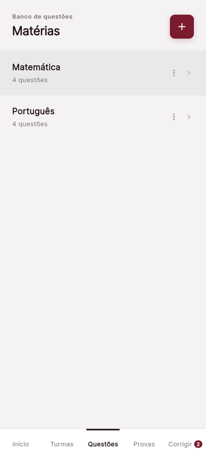
*Questões: banco de questões organizado por matéria.*

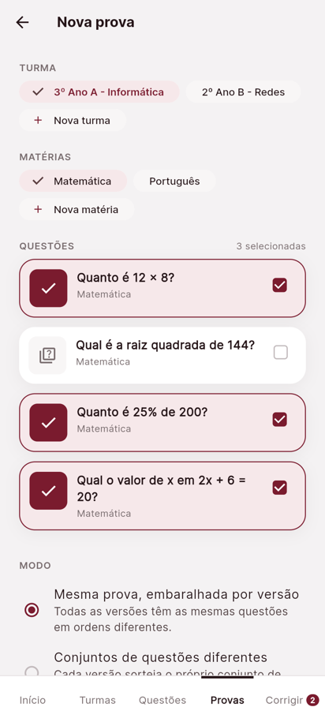
*Nova prova: turma, matérias, questões, modo de geração e quantidade de versões.*

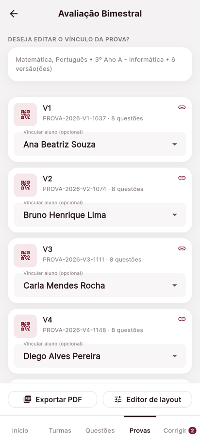
*Gerar versões: cada versão com seu QR code, vínculo opcional com aluno e exportação em PDF.*

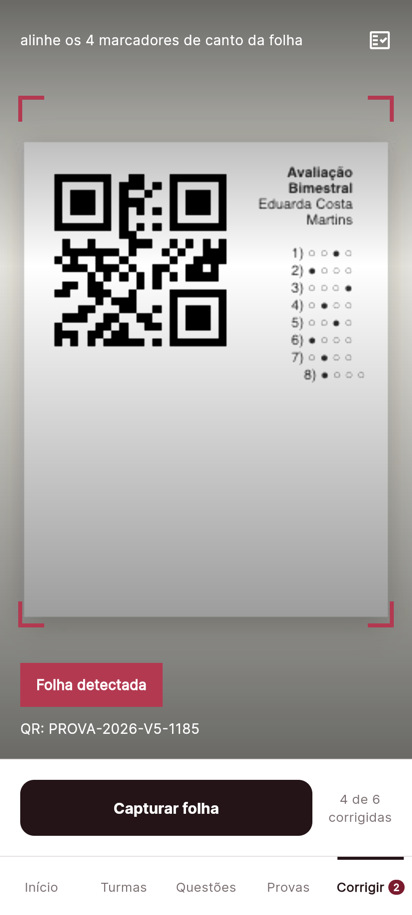
*Corrigir: câmera lendo o QR code da folha.*

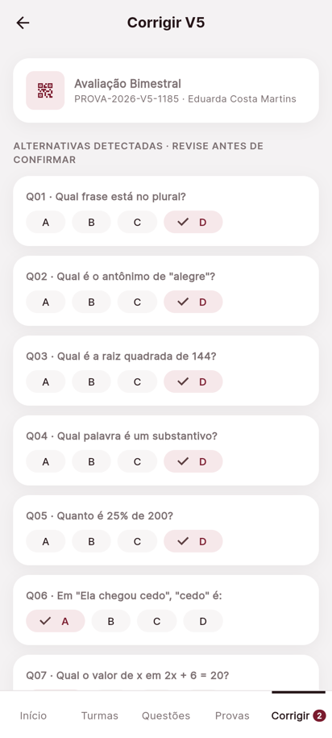
*Corrigir versão: o professor confere as alternativas e confirma a nota.*

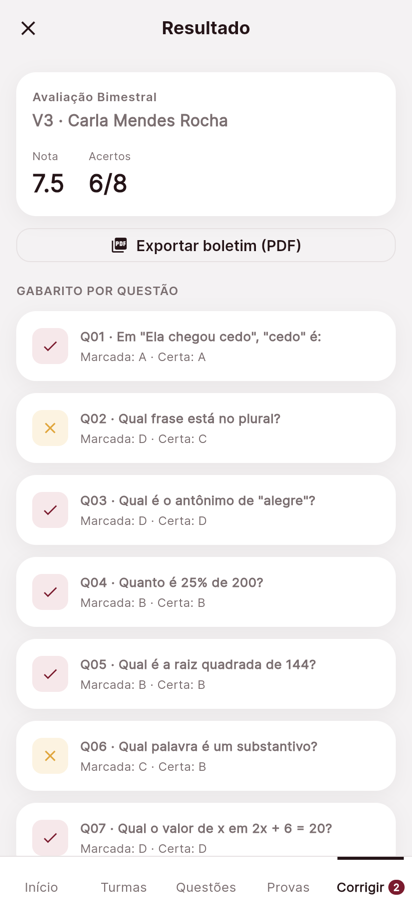
*Resultado: nota, acertos e gabarito por questão; exporta o boletim em PDF.*

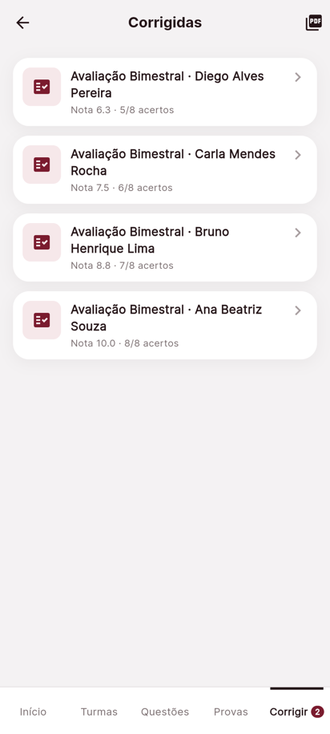
*Corrigidas: folhas já corrigidas com nota e acertos; exporta os boletins de todos em PDF.*

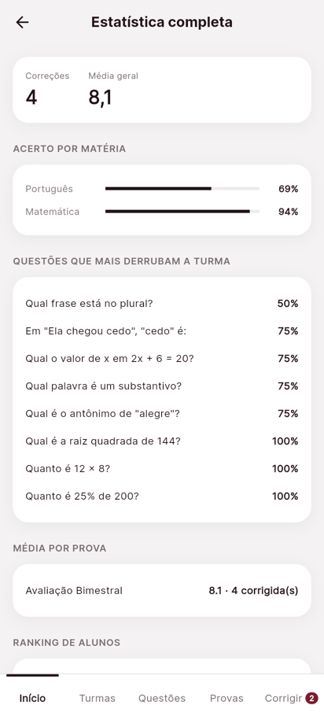
*Estatística completa: acerto por matéria, questões com mais erros, média por prova e ranking de alunos.*

#### Todas as telas e rotas

| Tela | Rota | O que faz |
|---|---|---|
| **Login** | `/login` | Entrar com e-mail e senha ou com conta Google |
| **Criar conta** | `/cadastro` | Cadastro do professor: nome, e-mail e senha |
| **Recuperar senha** | `/recuperar-senha` | Envia o link de redefinição de senha por e-mail |
| **Início** | `/inicio` | Corrigidas e pendentes, atalhos, erro por disciplina e os cartões de disciplina (com o "+" para criar) |
| **Estatística completa** | `/inicio/estatistica` | Acerto por disciplina, questões que mais derrubam a turma, alternativas marcadas por questão, média por prova e ranking |
| **Disciplinas** | `/turmas` | Cartões das disciplinas do professor |
| **Nova disciplina** | `/turmas/nova` | Cadastro de disciplina |
| **Disciplina** | `/turmas/:id` | Cartões das turmas da disciplina e "Nova turma" |
| **Turma** | `/turmas/:id/turma/:turmaId` | Abas **Alunos** (criar, editar, remover; ver a correção do aluno) e **Provas** (folhas, notas e planilha da turma) |
| **Importar alunos** | `/turmas/:id/turma/:turmaId/importar` | Importa nome e matrícula de uma planilha `.xlsx` |
| **Questões** | `/questoes` | Disciplinas do banco de questões |
| **Questões da disciplina** | `/questoes/disciplina/:disciplinaId` | Questões daquela disciplina |
| **Formulário de questão** | `/questoes/disciplina/:disciplinaId/questao` | Enunciado, alternativas e gabarito |
| **Provas geradas** | `/provas-geradas` | Provas criadas: abrir, editar, exportar DOCX e notas |
| **Nova prova** | `/criar-prova` | Nome, disciplina, turma, questões, opções (embaralhar alternativas, embaralhar questões, vincular a aluno) e quantidade de versões |
| **Nova questão na prova** | `/criar-prova/questao/:disciplinaId` | Cria uma questão na disciplina sem sair da prova |
| **Gerar versões** | `/gerar-provas` | Versões com letra e QR, vínculo com aluno e exportação do PDF |
| **Editor de layout** | `/gerar-provas/preview` | Ajusta a aparência da prova impressa |
| **Corrigir** | `/corrigir` | Câmera: lê o QR, valida a foto e mostra o progresso das correções |
| **Corrigir versão** | `/corrigir/versao` | Alternativas lidas da foto, revisão das não identificadas e confirmação da nota |
| **Resultado** | `/corrigir/resultado` | Nota, acertos e gabarito por questão; boletim em PDF |
| **Corrigidas** | `/corrigir/historico` | Folhas já corrigidas; boletins em PDF |

---|---|---|
| **Login** | `/login` | Entrar com e-mail e senha ou com conta Google |
| **Início** | `/inicio` | Painel do professor: corrigidas, pendentes e média; atalhos "Corrigir agora" e "Nova prova"; erro por matéria; últimas provas geradas |
| **Estatística completa** | `/inicio/estatistica` | Acerto por matéria, questões que mais derrubam a turma, média por prova e ranking de alunos |
| **Turmas** | `/turmas` | Lista das turmas |
| **Nova turma** | `/turmas/nova` | Cadastro de turma |
| **Detalhe da turma** | `/turmas/:id` | Alunos da turma: criar, editar, remover; editar ou excluir a turma |
| **Importar alunos** | `/turmas/:id/importar` | Importa nome e matrícula dos alunos de uma planilha `.xlsx` |
| **Questões** | `/questoes` | Banco de questões organizado por matéria |
| **Questões da matéria** | `/questoes/:materiaId` | Lista as questões daquela matéria |
| **Formulário de questão** | `/questoes/:materiaId/questao` | Enunciado, alternativas e marcação do gabarito |
| **Provas geradas** | `/provas-geradas` | Histórico das provas geradas; exporta as notas em Excel |
| **Nova prova** | `/criar-prova` | Nome, turma, matérias, seleção de questões, modo de geração e quantidade de versões |
| **Gerar versões** | `/gerar-provas` | Gera as versões embaralhadas, cada uma com seu QR; permite vincular aluno e exportar o PDF |
| **Editor de layout** | `/gerar-provas/preview` | Ajusta a aparência da prova impressa antes de exportar |
| **Corrigir** | `/corrigir` | Câmera com marcadores de canto e lanterna; lê o QR da folha e mostra quantas versões já foram corrigidas |
| **Corrigir versão** | `/corrigir/versao` | Revisão das alternativas da folha e confirmação da nota |
| **Resultado** | `/corrigir/resultado` | Nota, acertos e gabarito por questão; exporta o boletim em PDF |
| **Corrigidas** | `/corrigir/historico` | Lista das folhas já corrigidas; exporta os boletins de todos em PDF |

---

## 4. Modelo de Dados

📌 **N3**

Todos os dados ficam dentro do documento do professor autenticado, em `professores/{uid}`. As regras em `firestore.rules` só deixam cada professor ler e gravar no próprio caminho.

```
professores/{uid}/
├── turmas/{disciplinaId}         # uma DISCIPLINA, com as turmas e os alunos dentro
├── materias/{materiaId}          # só dados antigos (N2): matérias que apontam para uma disciplina
├── questoes/{questaoId}          # enunciado, alternativas, gabarito e disciplina
├── provas/{provaId}              # prova gerada: nome, disciplina, turma
│   └── versoes/{versaoId}        # versão (A, B, C…) com QR, aluno e questões na ordem impressa
└── correcoes/{correcaoId}        # alternativas marcadas e nota de uma versão
```

A coleção das disciplinas manteve o nome `turmas` da N2 para não perder os dados já salvos. Documentos antigos, com `alunos` direto na disciplina, são lidos como uma "Turma 1" e regravados no formato novo na primeira alteração.

#### Exemplo de documentos

```json
// professores/{uid}/turmas/turma_1732480000000  (disciplina)
{
  "nome": "Matemática",
  "qtdProvas": 1,
  "turmas": [
    {
      "id": "turma_1732480001000",
      "nome": "9º ano A",
      "alunos": [
        { "id": "a1", "nome": "Ana Souza", "matricula": "2026001" }
      ]
    }
  ]
}

// professores/{uid}/questoes/q_1732480002000
{
  "materiaId": "turma_1732480000000",
  "enunciado": "Quanto é 2 + 2?",
  "alternativas": ["3", "4", "5", "22"],
  "respostaCorreta": 1
}

// professores/{uid}/provas/pg_1732480003000
{
  "nome": "Prova bimestral",
  "materia": "Matemática",
  "disciplina": "Matemática",
  "turma": "9º ano A",
  "criadoEm": "2026-11-24T20:00:00Z",
  "totalVersoes": 2
}

// professores/{uid}/provas/pg_1732480003000/versoes/v1
{
  "qrCode": "PROVA-M3VX8K2A1C-V1",
  "alunoId": "a1",
  "professor": "Ana Lima",
  "materia": "Matemática",
  "disciplina": "Matemática",
  "turma": "9º ano A",
  "provaNome": "Prova bimestral",
  "questoes": [
    {
      "questaoId": "q_1732480002000",
      "materiaId": "turma_1732480000000",
      "enunciado": "Quanto é 2 + 2?",
      "alternativasOriginais": ["3", "4", "5", "22"],
      "respostaOriginal": 1,
      "alternativas": ["22", "4", "3", "5"],
      "respostaCorreta": 1
    }
  ]
}

// professores/{uid}/correcoes/cor_1732480004000
{
  "provaId": "pg_1732480003000",
  "versaoId": "v1",
  "provaNome": "Prova bimestral",
  "materia": "Matemática",
  "turma": "9º ano A",
  "alunoId": "a1",
  "alunoNome": "Ana Souza",
  "corrigidoEm": "2026-11-25T10:00:00Z",
  "respostas": [
    {
      "questaoId": "q_1732480002000",
      "materiaId": "turma_1732480000000",
      "enunciado": "Quanto é 2 + 2?",
      "alternativaMarcada": 1,
      "respostaCorreta": 1,
      "ordemNoBanco": [3, 1, 0, 2],
      "alternativasNoBanco": ["3", "4", "5", "22"]
    }
  ]
}
```

#### Dicionário de dados

**Disciplina** (`turmas/{disciplinaId}`)

| Campo | Tipo | Descrição |
|---|---|---|
| `nome` | string | Nome da disciplina |
| `qtdProvas` | number | Quantidade de provas geradas para a disciplina |
| `turmas` | array | Turmas da disciplina: `id`, `nome` e `alunos` |
| `turmas[].alunos[]` | array | Alunos da turma: `id`, `nome` e `matricula` |

**Questão** (`questoes/{questaoId}`)

| Campo | Tipo | Descrição |
|---|---|---|
| `materiaId` | string | Id da disciplina da questão (em dados da N2, id de uma matéria) |
| `enunciado` | string | Texto da questão |
| `alternativas` | array de string | Alternativas na ordem do banco (0 = A) |
| `respostaCorreta` | number | Índice da alternativa certa no banco |

**Prova** (`provas/{provaId}`)

| Campo | Tipo | Descrição |
|---|---|---|
| `nome` | string | Nome da prova |
| `materia` / `disciplina` | string | Nome da disciplina |
| `turma` | string | Nome da turma |
| `criadoEm` | timestamp | Data de criação |
| `totalVersoes` | number | Quantidade de versões geradas |

**Versão** (`provas/{provaId}/versoes/{versaoId}`)

| Campo | Tipo | Descrição |
|---|---|---|
| `qrCode` | string | Conteúdo do QR impresso no gabarito: `PROVA-<lote>-V<número>`, em que o lote vem do instante da geração, para o QR de uma versão nunca repetir o de outra prova |
| `alunoId` | string ou null | Aluno vinculado à versão |
| `professor` | string | Nome do professor impresso na prova |
| `disciplina`, `turma`, `provaNome` | string | Dados impressos no cabeçalho |
| `questoes[]` | array | Questões na ordem impressa: `alternativas` e `respostaCorreta` na ordem desta versão, `alternativasOriginais` e `respostaOriginal` como no banco |

**Correção** (`correcoes/{correcaoId}`)

| Campo | Tipo | Descrição |
|---|---|---|
| `provaId`, `versaoId` | string | Folha corrigida |
| `alunoId`, `alunoNome` | string ou null | Aluno da versão |
| `corrigidoEm` | timestamp | Data da correção |
| `respostas[].alternativaMarcada` | number | Alternativa marcada (ordem impressa) |
| `respostas[].respostaCorreta` | number | Alternativa certa (ordem impressa) |
| `respostas[].ordemNoBanco` | array de number | Para cada alternativa impressa, o índice dela no banco (junta versões embaralhadas na estatística) |
| `respostas[].alternativasNoBanco` | array de string | Cópia dos textos das alternativas na prova aplicada (editar a questão depois não muda o histórico) |

A nota não é gravada: é calculada a partir das respostas (acertos ÷ questões × 10).

---

## 5. Stack Tecnológica

📌 **N1**, ampliada na N2


- **Flutter**: framework usado para construir a interface e a navegação do app.
- **Dart**: linguagem de programação usada no Flutter.
- **Firebase Authentication**: login do professor com e-mail e senha ou conta Google.
- **Firebase Firestore**: banco de dados em nuvem (NoSQL) onde ficam turmas, questões, provas e correções.

### Principais pacotes

| Pacote | Para quê |
|---|---|
| `go_router` | navegação e rotas aninhadas |
| `provider` | injeção dos repositórios nas telas |
| `firebase_core` / `firebase_auth` / `cloud_firestore` | login e banco de dados |
| `google_sign_in` | login com Google nativo no Android |
| `pdf` / `printing` | montagem e exportação da prova e do boletim em PDF |
| `mobile_scanner` | leitura do QR code pela câmera |
| `file_picker` / `excel` | importação da lista de alunos e exportação das notas |
| `google_fonts` | tipografia da interface |
| `image` | leitura das marcações do gabarito (OMR) e verificação da qualidade da foto |

---

## 6. Estrutura de Pastas

📌 **N1**, atualizada na N2

```
lib/
├── main.dart                  # ponto de entrada: inicializa o Firebase e os repositórios
├── router/                    # rotas do go_router e shell das abas
├── theme/                     # cores, espaçamentos, tipografia e breakpoints
├── models/                    # turma, aluno, questão, versão de prova, correção, linha de nota
├── services/                  # autenticação, repositórios (Firestore e memória), mappers, PDF, Excel e estatística
├── widgets/                   # componentes reutilizáveis (cards, navegação)
└── screens/                   # uma pasta por área do app
    ├── auth/                  # login
    ├── inicio/                # painel inicial e estatística completa
    ├── turmas/                # turmas, alunos e importação
    ├── questoes/              # banco de questões
    ├── provas/                # criar, gerar, layout e histórico
    ├── corrigir/              # câmera, correção da versão, resultado e corrigidas
    └── shell/                 # casca com a navegação principal
test/                          # testes de repositórios, telas e serviços
firestore.rules                # regras de segurança do Firestore
docs/                          # documento do cliente, requisitos e protótipo
└── telas/                     # prints das telas usados neste README
```

Cada repositório tem duas implementações: uma no **Firestore**, usada pelo app, e uma **em memória**, usada nos testes.

---

## 7. Como Executar o Projeto

📌 **N1**, revisado na N2

### 7.1 Pré-requisitos

- Flutter SDK 3.x com Dart SDK ^3.13.1 (`flutter --version`)
- Acesso ao projeto Firebase `correcao-provas-grupo` (veja [7.3 Configurar o Firebase](#73-configurar-o-firebase))
- Para rodar em Android: Android Studio com o SDK instalado
- Para rodar no navegador: Google Chrome

### 7.2 Passos

```bash
git clone https://github.com/Pedro-Martins-Nascimento/flutter_dart.git
cd flutter_dart
flutter pub get
# gere os arquivos do Firebase antes de rodar (seção 7.3)
flutter run
```

Com mais de um dispositivo disponível, escolha o alvo:

```bash
flutter devices          # lista os dispositivos
flutter run -d chrome    # navegador
flutter run -d <id>      # emulador ou celular Android
```

O Firebase está configurado para **Android e Web**. No macOS, iOS, Windows e Linux o app não inicia.

A tela de Correção usa a câmera: no navegador, aceite a permissão quando o Chrome pedir; no Android, a permissão é solicitada na primeira abertura da tela.

### 7.3 Configurar o Firebase

O projeto usa `firebase_core`, `firebase_auth` e `cloud_firestore`. Os arquivos gerados pelo FlutterFire **não são versionados**:

- `lib/firebase_options.dart`
- `android/app/google-services.json`

Cada integrante gera esses arquivos na própria máquina. Não é necessário enviá-los por mensagem nem adicioná-los ao GitHub.

#### O que cada integrante precisa ter

- Flutter e Dart instalados e funcionando (`flutter doctor`)
- Uma conta Google com acesso ao projeto Firebase `correcao-provas-grupo`
- Firebase CLI instalado e autenticado
- FlutterFire CLI instalado
- Android Studio e Android SDK, caso vá compilar para Android
- Google Chrome, caso vá rodar na Web

#### Configuração inicial da máquina

```bash
firebase login
dart pub global activate flutterfire_cli
```

Depois de clonar o repositório, dentro da pasta do projeto, execute:

```bash
flutter pub get
flutterfire configure --project=correcao-provas-grupo --platforms=android,web
```

Durante o comando, confirme o aplicativo Android do projeto (`com.example.flutter_dart`). O FlutterFire gera localmente `lib/firebase_options.dart` e `android/app/google-services.json`; eles já estão protegidos pelo `.gitignore`.

Se alguém não tiver permissão no projeto Firebase, um integrante com acesso deve adicioná-lo no Firebase Console. Não compartilhe senhas, tokens ou chaves privadas; compartilhe apenas o nome do projeto e o acesso autorizado.

#### Login com Google no Android

No Android, o login com Google é feito pelo login nativo (`google_sign_in`), e o Firebase só aceita o app se a **SHA-1 da chave que assinou o APK** estiver cadastrada no projeto.

1. Veja a SHA-1 da sua chave de debug:

   ```bash
   keytool -list -v -alias androiddebugkey -keystore ~/.android/debug.keystore -storepass android
   ```

2. Confira se ela já está cadastrada; se não estiver, cadastre:

   ```bash
   firebase apps:android:sha:list 1:184286969361:android:cde5f2bdad65325b303bb0 --project correcao-provas-grupo
   firebase apps:android:sha:create 1:184286969361:android:cde5f2bdad65325b303bb0 <SHA-1> --project correcao-provas-grupo
   ```

3. Gere de novo o `google-services.json` (com `flutterfire configure` ou baixando pelo Firebase Console) para ele trazer os clientes OAuth.

Na Web, o login com Google abre um popup. Se nada acontecer ao clicar, verifique se o navegador bloqueou o popup.

#### Regras do Firestore

As regras ficam em `firestore.rules` e são publicadas com:

```bash
firebase deploy --only firestore:rules --project correcao-provas-grupo
```

### 7.4 Verificar o projeto

```bash
flutter analyze
flutter test
```

Os testes não dependem do Firebase: usam `fake_cloud_firestore` e `firebase_auth_mocks`.

### 7.5 Gerar o APK

```bash
flutter build apk --release
```

Com o Flutter 3.50 ou mais novo, o build reclama que o Android Gradle Plugin do projeto (9.1.0) está abaixo do mínimo; enquanto ele não for atualizado, gere com:

```bash
flutter build apk --release --android-skip-build-dependency-validation
```

O arquivo sai em `build/app/outputs/flutter-apk/app-release.apk`. Para distribuir, renomeie com a versão do `pubspec.yaml` — por exemplo, `correcao-de-provas-v1.0.0.apk`.

O build de release ainda é assinado com a chave de debug de quem gerou o APK. Por isso, o login com Google só funciona se a SHA-1 dessa máquina estiver cadastrada no Firebase (veja a seção 7.3).

Ao instalar uma versão nova por cima da antiga, o Android pode manter o app anterior porque o número da versão é o mesmo. Se isso acontecer, desinstale o app antes de instalar o APK novo, ou aumente o `version` no `pubspec.yaml`.

---

## 8. Backlog de Atividades

Backlog real, montado a partir dos Pull Requests do repositório. A data é a do merge do PR.

### 8.1 N3

📌 **N3**

#### Kelcia Antiuk

| Tarefa | Prazo | Status |
|---|---|---|
| README da N2 ([#37](https://github.com/Pedro-Martins-Nascimento/flutter_dart/pull/37)) | 29/10 | Concluído |
| Verificar foco, luz e marcadores antes de corrigir ([#40](https://github.com/Pedro-Martins-Nascimento/flutter_dart/pull/40)) | 12/11 | Concluído |
| Tela de cadastro de professor ([#41](https://github.com/Pedro-Martins-Nascimento/flutter_dart/pull/41); o [#42](https://github.com/Pedro-Martins-Nascimento/flutter_dart/pull/42) foi fechado sem merge) | 12/11 | Concluído |
| Interface minimalista, edição de prova e menu da conta ([#43](https://github.com/Pedro-Martins-Nascimento/flutter_dart/pull/43)) | 13/11 | Concluído |
| Disciplinas → Turmas → Alunos, caderno e gabarito separados, vínculo de alunos, opções de embaralhamento e planilha da turma ([#52](https://github.com/Pedro-Martins-Nascimento/flutter_dart/pull/52)) | 22/11 | Concluído |
| Nome do professor na prova sem usar o e-mail ([#56](https://github.com/Pedro-Martins-Nascimento/flutter_dart/pull/56)) | 24/11 | Concluído |
| README da N3 | 25/11 | Em revisão |

#### Pedro Martins do Nascimento

| Tarefa | Prazo | Status |
|---|---|---|
| Remover o professor de desenvolvimento e tratar a falta de login ([#44](https://github.com/Pedro-Martins-Nascimento/flutter_dart/pull/44)) | 14/11 | Concluído |
| Remover código legado e mocks de `lib` ([#45](https://github.com/Pedro-Martins-Nascimento/flutter_dart/pull/45)) | 14/11 | Concluído |
| Aviso global de falta de conexão ([#46](https://github.com/Pedro-Martins-Nascimento/flutter_dart/pull/46)) | 14/11 | Concluído |
| Exportação de provas em DOCX ([#47](https://github.com/Pedro-Martins-Nascimento/flutter_dart/pull/47), [#49](https://github.com/Pedro-Martins-Nascimento/flutter_dart/pull/49)) | 18/11 | Concluído |
| Code review dos PRs da N3 | 24/11 | Concluído |

#### Karen Amancio

| Tarefa | Prazo | Status |
|---|---|---|
| Constantes de layout da folha compartilhadas entre PDF e leitor ([#38](https://github.com/Pedro-Martins-Nascimento/flutter_dart/pull/38)) | 11/11 | Concluído |
| Questões sem corte entre páginas do PDF ([#39](https://github.com/Pedro-Martins-Nascimento/flutter_dart/pull/39)) | 15/11 | Concluído |
| Recuperação de senha por e-mail ([#48](https://github.com/Pedro-Martins-Nascimento/flutter_dart/pull/48)) | 18/11 | Concluído |
| Relatório de notas em Excel com matrícula, nome, nota e data ([#50](https://github.com/Pedro-Martins-Nascimento/flutter_dart/pull/50)) | 18/11 | Concluído |

#### Letícia Parpineli

| Tarefa | Prazo | Status |
|---|---|---|
| Correção pelo QR code ([#51](https://github.com/Pedro-Martins-Nascimento/flutter_dart/pull/51), fechado sem merge) | 22/11 | Fechado |

#### Eduardo

| Tarefa | Prazo | Status |
|---|---|---|
| Leitor de marcações (OMR) do gabarito ([#54](https://github.com/Pedro-Martins-Nascimento/flutter_dart/pull/54), reaplicado no [#55](https://github.com/Pedro-Martins-Nascimento/flutter_dart/pull/55)) | 24/11 | Concluído |
| Regra de marcação dupla, em branco e rasura, e leitor ligado à correção ([#55](https://github.com/Pedro-Martins-Nascimento/flutter_dart/pull/55)) | 24/11 | Concluído |
| Distribuição das alternativas por questão na estatística ([#53](https://github.com/Pedro-Martins-Nascimento/flutter_dart/pull/53)) | 24/11 | Concluído |

### 8.2 N2

📌 **N2**

#### Kelcia Antiuk

| Tarefa | Prazo | Status |
|---|---|---|
| Regras de segurança do Firestore por professor ([#18](https://github.com/Pedro-Martins-Nascimento/flutter_dart/pull/18), [#20](https://github.com/Pedro-Martins-Nascimento/flutter_dart/pull/20)) | 15/10 | Concluído |
| Login com Firebase Authentication: e-mail/senha e conta Google ([#19](https://github.com/Pedro-Martins-Nascimento/flutter_dart/pull/19)) | 15/10 | Concluído |
| Ajustes de erros gerais ([#36](https://github.com/Pedro-Martins-Nascimento/flutter_dart/pull/36)) | 27/10 | Concluído |
| README v2 ([#37](https://github.com/Pedro-Martins-Nascimento/flutter_dart/pull/37)) | 30/10 | Em revisão |
| Code review dos PRs #15, #16, #26, #30 e #31 | 25/10 | Concluído |

#### Pedro Martins do Nascimento

| Tarefa | Prazo | Status |
|---|---|---|
| Extrair os modelos de domínio para `lib/models` ([#15](https://github.com/Pedro-Martins-Nascimento/flutter_dart/pull/15)) | 05/10 | Concluído |
| Configurar o Firebase no projeto Flutter ([#16](https://github.com/Pedro-Martins-Nascimento/flutter_dart/pull/16)) | 09/10 | Concluído |
| Matérias e questões no Firestore ([#30](https://github.com/Pedro-Martins-Nascimento/flutter_dart/pull/30)) | 24/10 | Concluído |
| Code review dos PRs #17 a #29 e #32 a #36 | 27/10 | Concluído |

#### Karen Amancio

| Tarefa | Prazo | Status |
|---|---|---|
| Migrar provas e versões para o `ProvaRepository` ([#17](https://github.com/Pedro-Martins-Nascimento/flutter_dart/pull/17)) | 14/10 | Concluído |
| PDF e editor de layout recebem os dados da prova por parâmetro ([#22](https://github.com/Pedro-Martins-Nascimento/flutter_dart/pull/22)) | 17/10 | Concluído |
| Relatório de notas em `.xlsx` ([#23](https://github.com/Pedro-Martins-Nascimento/flutter_dart/pull/23)) | 17/10 | Concluído |
| Provas e versões salvas no Firestore ([#24](https://github.com/Pedro-Martins-Nascimento/flutter_dart/pull/24)) | 17/10 | Concluído |
| Rota do editor de layout usa o repositório do router ([#27](https://github.com/Pedro-Martins-Nascimento/flutter_dart/pull/27)) | 24/10 | Concluído |
| Testes do `ProvaRepository` do Firestore e correção do editar ([#28](https://github.com/Pedro-Martins-Nascimento/flutter_dart/pull/28)) | 24/10 | Concluído |
| Exportar notas da prova ([#29](https://github.com/Pedro-Martins-Nascimento/flutter_dart/pull/29)) | 24/10 | Concluído |
| Boletim em PDF e estatística completa ([#32](https://github.com/Pedro-Martins-Nascimento/flutter_dart/pull/32)) | 25/10 | Concluído |
| Correção da versão e tela de resultados ([#33](https://github.com/Pedro-Martins-Nascimento/flutter_dart/pull/33)) | 25/10 | Concluído |
| Selo de pendentes na aba Corrigir ([#34](https://github.com/Pedro-Martins-Nascimento/flutter_dart/pull/34)) | 25/10 | Concluído |
| Aviso de planilha salva ao exportar notas no navegador ([#35](https://github.com/Pedro-Martins-Nascimento/flutter_dart/pull/35)) | 25/10 | Concluído |

#### Letícia Parpineli

| Tarefa | Prazo | Status |
|---|---|---|
| Turmas e alunos no Firestore ([#26](https://github.com/Pedro-Martins-Nascimento/flutter_dart/pull/26), substituiu o [#25](https://github.com/Pedro-Martins-Nascimento/flutter_dart/pull/25), fechado sem merge) | 24/10 | Concluído |
| Testes das turmas ([#31](https://github.com/Pedro-Martins-Nascimento/flutter_dart/pull/31)) | 25/10 | Concluído |

#### Eduardo

| Tarefa | Prazo | Status |
|---|---|---|
| Correções, resultados e estatística no Firestore ([#21](https://github.com/Pedro-Martins-Nascimento/flutter_dart/pull/21)) | 17/10 | Concluído |

---

## 9. Como o grupo trabalha

Nada vai direto para a `main`: cada tarefa vira uma branch, que só entra no projeto por **commit → Pull Request → code review de um colega → merge**.

---

## 10. Documentação de apoio

- [docs/correcao-de-provas-docs.md](docs/correcao-de-provas-docs.md) — requisitos e decisões fechadas com o cliente
- [docs/Relato do cliente.pdf](docs/Relato%20do%20cliente.pdf) — pedido original do cliente
- [docs/Escopo do Projeto.pdf](docs/Escopo%20do%20Projeto.pdf) — escopo e critérios da disciplina
- [docs/appProvas.html](docs/appProvas.html) — protótipo navegável usado como referência visual

---

<div align="center">

*README elaborado para a disciplina de Desenvolvimento de Dispositivos Móveis*

</div>
